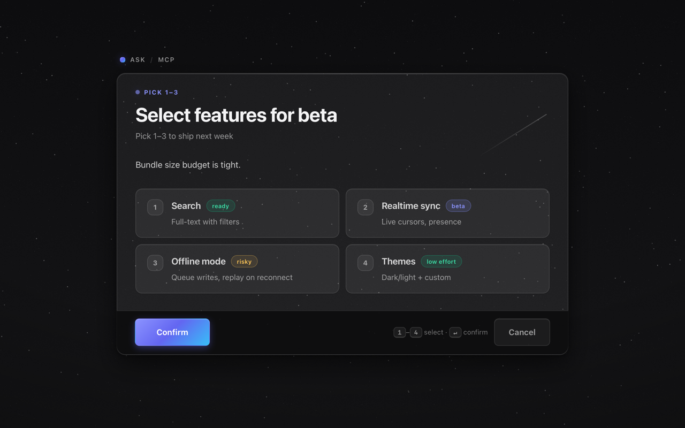
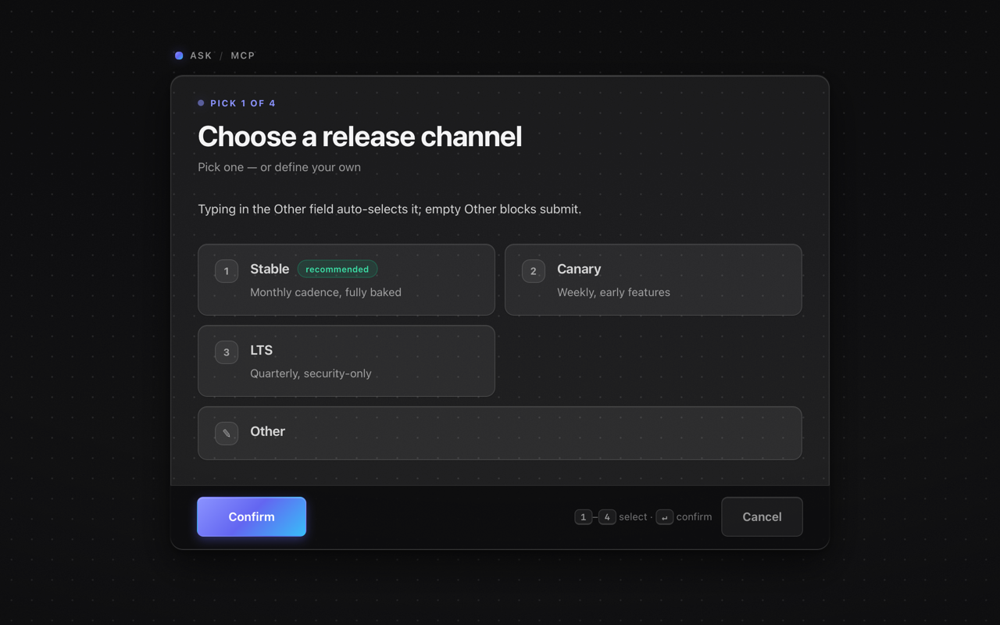
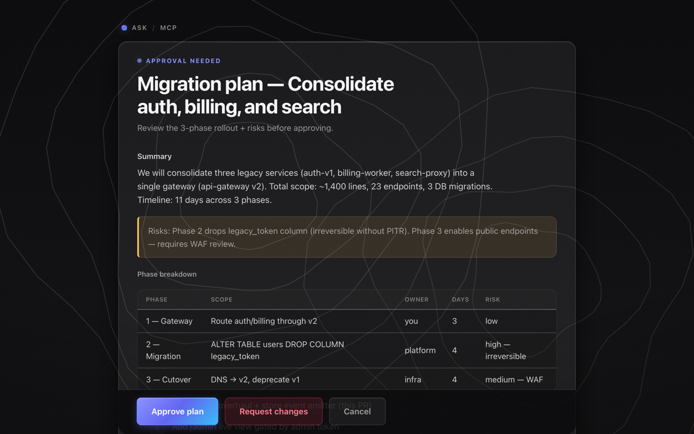
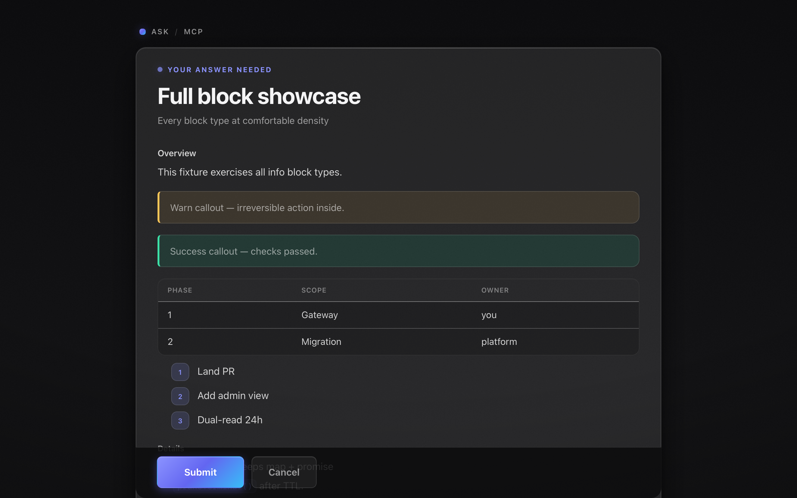

# ask-mcp

[](https://www.npmjs.com/package/@pylotlight/ask-mcp)
[](package.json)
[](package.json)

An MCP tool that asks **you** questions — as real HTML forms in the browser. The agent calls `ask`, a form opens, and the call blocks until you answer. Approvals, choices, tables, markdown, short forms in; structured, validated answers out.

## How it works

1. The agent calls `ask` with a title, context blocks, and an input.
2. A form opens in your browser. The tool call waits — minutes, not seconds.
3. You answer, cancel, or it times out. The agent gets validated structured data.

Built-in question tools (opencode's `question`, Claude Code's `AskUserQuestion`) render as inline chat chips: no room for context, loose free-text answers, nothing saved afterwards. ask-mcp gives every question a proper surface instead — with a live queue you can cancel from an admin panel, a history of every spec and response, and archived renders of exactly what you saw.

## Screenshots

**Choice cards** — multi-select grid over the starfield background.



**Free-text escape hatch** — the Other option over the dot-grid background.



**Plan approval** — long-form context with the sticky action bar over contour lines.



**Info blocks** — headings, tables, callouts, and diffs on minimal.



## Install

Recommended — the client spawns the server over stdio (no port to manage; form pages still open over loopback HTTP):

```bash
bunx @pylotlight/ask-mcp --stdio     # Bun
npx -y @pylotlight/ask-mcp --stdio   # npm / Node
```

Or install globally and run the same flag:

```bash
npm i -g @pylotlight/ask-mcp          # → `ask-mcp --stdio`
```

Requires Node ≥ 22 or Bun ≥ 1.2.

### Connect your client

One command — detects opencode, Claude Code, and Claude Desktop, adds the `ask` server to each, and installs `/ask-admin`:

```bash
npx -y @pylotlight/ask-mcp install
```

Existing entries are left alone unless `--force`; every touched file is backed up to `.bak` first.

- `--client opencode|claude-code|claude-desktop` — target one client (default: all detected)
- `--bun` — launch via `bunx --bun` (Bun runtime; plain `bunx` uses the Node shebang)
- `--force` — overwrite an existing `ask` entry

The installer also sets opencode's `experimental.mcp_timeout`: blocking asks need a long tool timeout (client defaults ~30 s kill them — ten minutes is a good start; match it with `--timeout-ms`).

Other MCP clients: launch the package over stdio — command `bunx`, args `["@pylotlight/ask-mcp", "--stdio"]` (or command `npx`, args `["-y", "@pylotlight/ask-mcp", "--stdio"]`; `bunx --bun …` for the Bun runtime). A small loopback HTTP server serves the form pages (falls back to a free port if 8787 is busy).

Running the agent on a NAS / container / remote pod? Same binary, hosted flags: `--host 0.0.0.0 --port <n> --base-url https://<public-origin>` plus tokens — see [docs/hosting.md](docs/hosting.md).

## Slash command (opencode / openchamber)

```bash
npx -y @pylotlight/ask-mcp install-commands   # installs /ask-admin
```

`/ask-admin` opens the admin panel in the browser. All `ask` flows stay agent-driven via the MCP tools. See [docs/commands.md](docs/commands.md).

## Admin panel

`/admin` just opens on the default localhost bind — no setup. Live asks with one-click cancel, the artifact history trail, a config editor (safe fields apply live), and template CRUD. A token (`--admin-token`, falling back to `--auth-token`) adds a sign-in gate for shared machines and network binds. See [docs/admin.md](docs/admin.md).

## Features

- **Five input kinds** — `approve`, `single_choice`, `multi_choice`, `text`, `form`, with type inference and server-side validation.
- **Other escape hatch** — choice prompts accept `other: { placeholder }`: typing auto-selects it, empty blocks submit, the answer arrives as `otherText`.
- **Info blocks** — headings, paragraphs, markdown (safe subset), callouts, steps, option cards, tables, diffs, dividers.
- **Dry run** — `dryRun: true` validates, renders, and archives without blocking, opening, or prompting. Self-check a form before the real call.
- **Artifacts** — every ask persisted (`spec.json`, `response.json`, `render.html`) under `~/.config/ask-mcp/YYYY-MM-DD/<token>/`, with retention pruning.
- **Live pages** — status tracked over SSE; after answering, a settle view shows what was recorded plus a permalink, with auto-close countdown + Close now / Stay open / Copy link (`--settle-view-ms`, default 3 s; `0` stays open).
- **Keyboard-first** — `1`–`9` to pick, `Enter` to confirm, `⌘/Ctrl+Enter` from text areas.
- **Themes** — four monochrome form backgrounds (`minimal`, `starfield`, `dots`, `contour`) with tunable density and motion, per-install or live from the admin Config tab.
- **HTTP twin** — `POST /api/ask` + `GET /api/templates` give scripts and CI the same pipeline as the MCP tool.
- **Safe by construction** — escaped rendering, strict schemas, per-ask 128-bit capability tokens, strict CSP, loopback-by-default binding.

## Docs

- [docs/ask-tool.md](docs/ask-tool.md) — input kinds, inference rules, result shapes, templates
- [docs/admin.md](docs/admin.md) — the admin panel
- [docs/commands.md](docs/commands.md) — templates, HTTP API, slash command
- [docs/hosting.md](docs/hosting.md) — hosted / reverse-proxy mode (NAS, containers, OpenChamber)
- [docs/reference.md](docs/reference.md) — CLI flags, security model, development, roadmap
